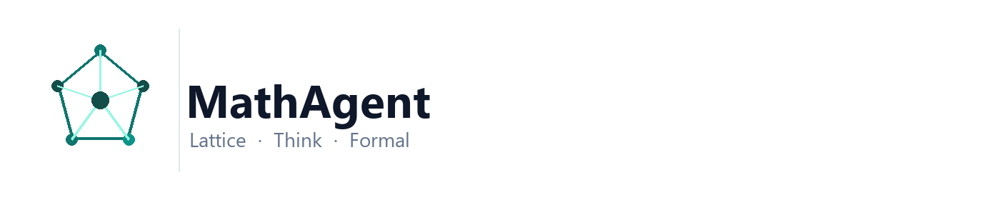
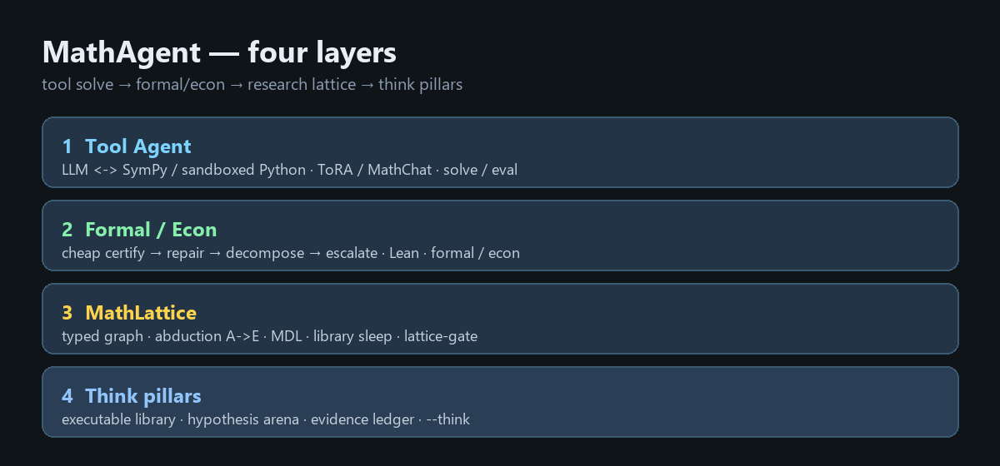
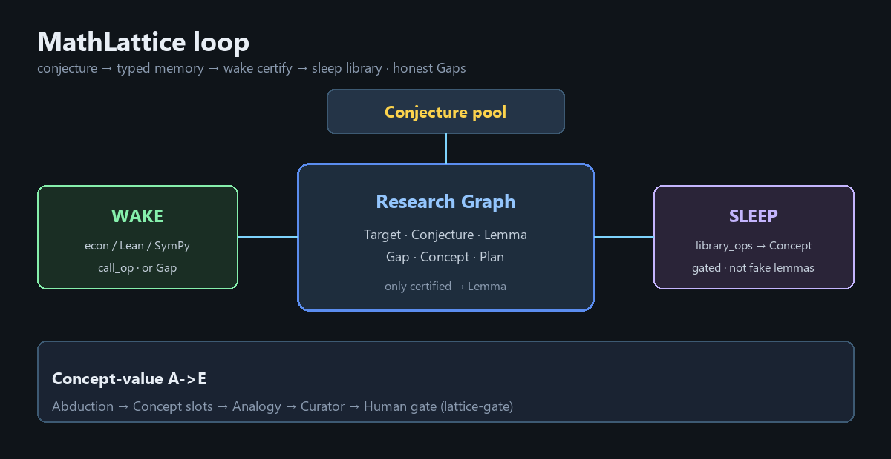
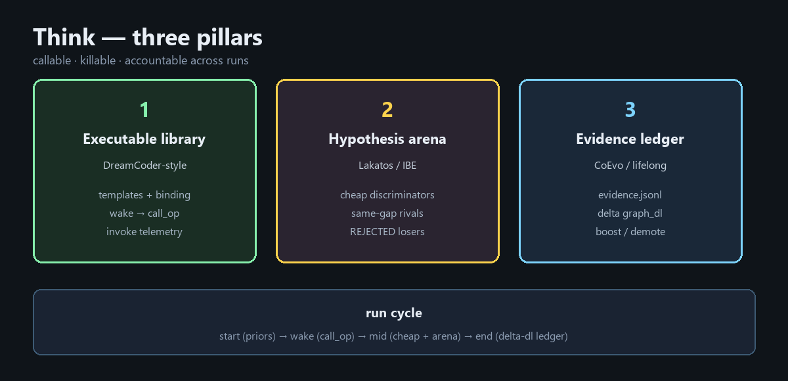

<div align="center">

# MathAgent: Low-Resource AI for Mathematical Research Reasoning

**Towards Lattice · Think · Formal — conceptual math agents under laptop budgets.**



<br/>

[](LICENSE)
[](https://www.python.org/)
[](docs/README.md)
[](tests/)
[](docs/TRY_LOCAL_AND_MATHLIB.md)
[](https://github.com/hongwei-2026/mathagent)

📖 [English](README_en.md) | [中文](README.md)

</div>

**MathAgent** is a low-resource open stack for mathematical reasoning: a contest-style **tool agent (ToRA / MathChat)**, **Formal / Econ** cheap certification, research-oriented **MathLattice** graph memory, and **Think pillars** that push toward conceptual cognition (executable library · hypothesis arena · cross-run evidence). It leans on **SymPy / Lean / DeepSeek-compatible APIs** and refuses to treat unverified narrative as proof.

> **Honesty:** Fields-level results are not “one API call.” This repo maximizes *certifiable progress* and records open gaps as explicit `Gap` / `HUMAN_REVIEW` nodes.

---

## Docs

| Doc | Topic |
|-----|--------|
| [docs/README.md](docs/README.md) | Reading order |
| [docs/LOW_COST_PATH.md](docs/LOW_COST_PATH.md) | Econ / selective CoT |
| [docs/LATTICE_ARCHITECTURE.md](docs/LATTICE_ARCHITECTURE.md) | Research graph, A→E, MDL, library sleep |
| [docs/THINK_ARCHITECTURE.md](docs/THINK_ARCHITECTURE.md) | Three Think pillars |
| [docs/TRY_LOCAL_AND_MATHLIB.md](docs/TRY_LOCAL_AND_MATHLIB.md) | Lean / mathlib / local 7B |

---

## Four layers

<div align="center">

</div>

| Layer | CLI | Use when |
|-------|-----|----------|
| 1 | `solve` / `eval` / UI | Standard problems, tool loop |
| 2 | `formal` / `econ` / `lean-check` | Need certificates, tight budget |
| 3 | `lattice` / `lattice-gate` | Open problems, honest gaps |
| 4 | `lattice --think` | Competing concepts, library ops, evidence |

---

## MathLattice

<div align="center">

</div>

```bash
mathagent lattice "Twin primes: map certifiable lemmas and mark the open gap"
mathagent lattice "..." --concept-value
mathagent lattice-gate <project> <concept_id> accept --note "..."
```

## Think pillars

<div align="center">

</div>

```bash
mathagent lattice "..." --think --auto-accept   # smoke only
```

See Chinese README for full setup, Lean paths, layout, and design doctrine: [README.md](README.md).

## License

MIT — [LICENSE](LICENSE).
